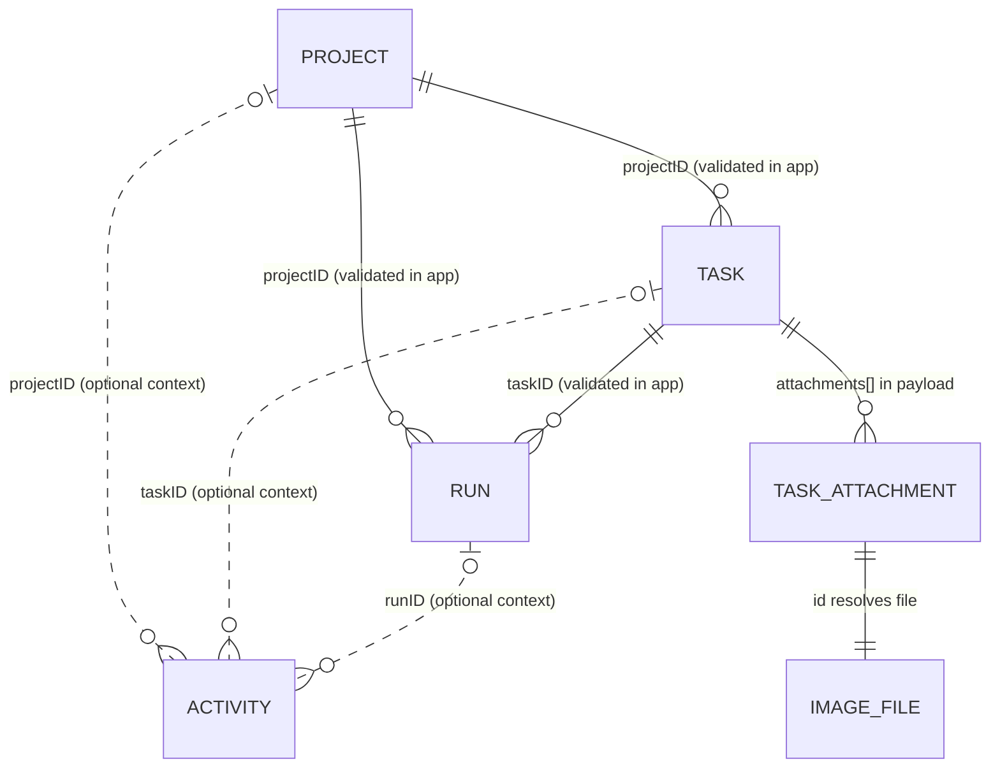
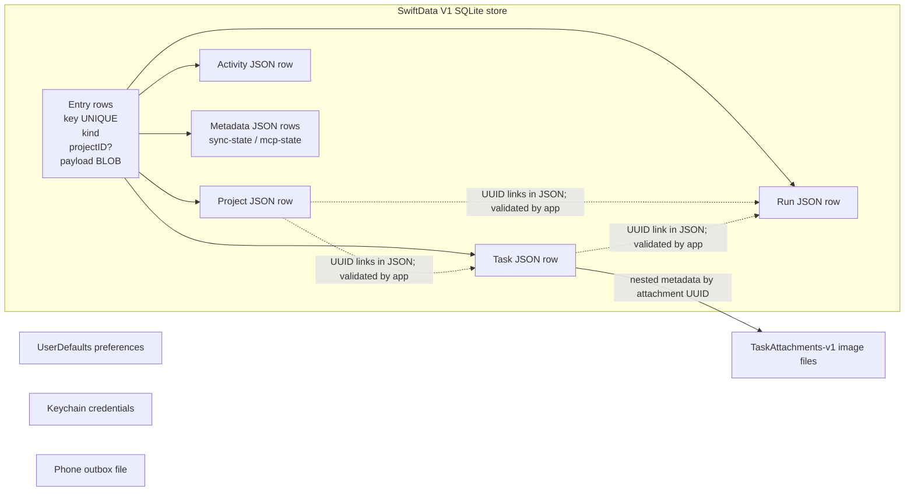

# StageChase data model

This document describes the persisted model in the repository as it is currently
implemented. It separates the physical SwiftData/SQLite layout from the logical
entities encoded inside each row. Field types below are the Swift model types;
most logical fields are JSON values inside a `Data` payload rather than SQLite
columns.

## Persistence overview

The Mac library is stored at
`~/Library/Application Support/StageChase/Library-v2.sqlite`. SwiftData schema
`StageSchemaV1` has one model, `Entry`. Its columns are:

| Column | Swift / logical type | Required | Meaning |
| --- | --- | --- | --- |
| `key` | `String` | yes | Stable row key. `@Attribute(.unique)`; prefixes identify entity kinds. |
| `kind` | `String` | yes | Row discriminator: `project`, `task`, `run`, `activity`, or `metadata`. |
| `projectID` | `UUID?` | no | Denormalized project lookup/context value; absent on global metadata. |
| `payload` | `Data` (SQLite BLOB) | yes | Sorted-key JSON encoding of the logical record. |

Typical keys are `p:<project UUID>`, `t:<task UUID>`, `r:<run UUID>`, and
`a:<activity UUID>`. Metadata uses fixed keys such as `schema`, `sync-state`,
and `mcp-state`. `key` is the row identity; the payload also contains the
logical entity's own `id` where it has one. The repeated `projectID` column is
not a relationship constraint and is not the source of truth for decoding.

The repository compares cached entities and upserts only changed rows. One
SwiftData save commits a mutation's changed entity rows and metadata together.
On load, it fetches the entries, decodes them into the in-memory `Library`,
validates the logical relationships, and serves subsequent board queries from
that library. The Mac is authoritative; the iPhone replica uses the same schema
in a separate `Replica-<library UUID>.sqlite` store and does not recover active
runs on launch.

### Physical indexes

- **Declared unique index:** `Entry.key` (`@Attribute(.unique)`). This is also
  the repository's point-lookup key for updates and deletes.
- **No app-declared indexes:** there is no `#Index`, `@Relationship`, or SQL
  index defined for `kind`, `projectID`, task status, timestamps, or the UUIDs
  inside JSON payloads. SwiftData/SQLite may maintain internal implementation
  indexes; this document does not treat undocumented internals as app indexes.
- Because the logical columns are JSON inside `payload`, SQLite cannot use a
  conventional relational index for logical fields without an explicit
  schema/index change. Current board filtering and sorting runs over the loaded
  in-memory arrays. Initial load reads all record history; it is not paginated.

### Foreign keys and integrity

There are **no SQLite foreign-key constraints**. The logical links below are
UUID values checked by `Library.validate()` when a library is accepted or
restored. Deleting a project is soft deletion: its record and associated tasks,
runs, activity, and image files remain. Task deletion removes the task and its
attachment files; historical activity can retain optional IDs as context.
Activity references are intentionally nullable and are not checked by the
library validator.

The `TASK_ATTACHMENT` and `IMAGE_FILE` boxes in the diagram are conceptual:
attachments are nested values in a task payload, and image bytes are separate
files, not rows. Their IDs and checksums connect metadata to file contents.

## Logical entities

`required` below means non-optional in the Swift model. A `?` means the field
may be absent/null. Collection fields are encoded as JSON arrays or objects.
Raw-value enums are JSON strings except `TaskPriority`, whose raw values are
integers. Associated-value Codable enums (such as model selection) use their
compiler-generated tagged JSON representation.

### Project (`kind = "project"`)

| Field | Type | Notes |
| --- | --- | --- |
| `id` | `UUID` | Logical primary identity; defaults to a new UUID. |
| `name` | `String` | Required display name. |
| `emoji` | `String?` | Optional normalized single grapheme. |
| `directory` | `String` | Project working folder; defaults to empty string. |
| `automationEnabled` | `Bool` | Project automation choice; defaults `false`. |
| `usesWorktrees` | `Bool` | Whether runs use task worktrees; defaults `false`. |
| `modelOverride` | `CodexModelConfiguration?` | Optional selection and reasoning-effort value. |
| `executionProfile` | `CodexExecutionProfile` | Enum; missing older values default to restricted workspace access. |
| `deployedCommitHash` | `String?` | Legacy inert metadata retained for compatibility. |
| `deployedAt` | `Date?` | Legacy inert timestamp. |
| `favoriteMakeTargets` | `[String]` | Ordered list; defaults empty. |
| `createdAt` | `Date` | Defaults to creation time. |
| `projectOrder` | `Int?` | User-selected position; nil is normalized on load. |
| `deletedAt` | `Date?` | Soft-delete timestamp; nil means active. |
| `deletionRevision` | `Int` | Nonnegative lifecycle revision; defaults zero. |

Project identity is unique across the decoded library. Project order is a model
invariant, not a database index or unique constraint.

`CodexModelConfiguration` is nested JSON with `selection: CodexModelSelection`
and `effort: String`. Selection is either `latestLuna` or `model(String)`.
`CodexExecutionProfile` is `workspaceAccessNoPrompts` or
`fullAccessNoPrompts`.

### Task (`kind = "task"`; Swift type `WorkItem`)

| Field | Type | Notes |
| --- | --- | --- |
| `id` | `UUID` | Logical primary identity. |
| `shortID` | `Int?` | Library-wide human-facing number; positive and unique when assigned. |
| `projectID` | `UUID` | Logical reference to `Project.id`; validated in app code. |
| `title` | `String` | Required title. |
| `notes` | `String` | Defaults empty. |
| `stage` | `WorkflowStage` | Raw-string enum: `inbox`, `next`, `planned`, `implementation`, `review`; retained for compatibility. |
| `section` | `WorkflowSection` | Raw-string enum: `inbox`, `planning`, `implementing`; current board placement. |
| `status` | `TaskStatus` | Raw-string enum (`triage`, `planning`, `ready`, `building`, `waiting`, `error`, `quota`, `review`); `done` decodes as `review`. |
| `rank` | `Int` | Within-section ordering value; defaults zero. |
| `completed` | `Bool` | Explicit user completion flag; defaults false. |
| `priority` | `TaskPriority?` | Integer enum: high `1`, medium `2`, low `3`. |
| `modelTag` | `TaskModelTag?` | String enum: `high` or `medium`. |
| `isFavorite` | `Bool` | Defaults false. |
| `revision` | `Int` | Optimistic-concurrency revision; defaults zero. |
| `planPath` | `String?` | Relative/selected plan path when set. |
| `planAvailable` | `Bool` | Cached availability marker; defaults false. |
| `latestCodexUpdate` | `String?` | Latest public task update. |
| `latestCodexUpdateAt` | `Date?` | Timestamp for that update. |
| `modelOverride` | `CodexModelConfiguration?` | Optional per-task model selection and effort. |
| `createdAt` | `Date` | Creation timestamp. |
| `updatedAt` | `Date` | Last mutation timestamp; older payloads default to `createdAt`. |
| `completedAt` | `Date?` | Completion timestamp when available. |
| `attachments` | `[TaskAttachment]` | Nested attachment metadata array; image bytes are external files. |

`WorkflowStage` and `WorkflowSection` intentionally coexist: the section is the
current three-lane placement; stage is the legacy five-stage vocabulary used
for compatibility. `status` and `completed` are also separate fields.

### Run (`kind = "run"`; Swift type `AgentRun`)

| Field | Type | Notes |
| --- | --- | --- |
| `id` | `UUID` | Logical primary identity. |
| `taskID` | `UUID` | Required logical reference to `WorkItem.id`. |
| `projectID` | `UUID` | Required logical reference to `Project.id`. |
| `kind` | `RunKind` | String enum: `planning`, `implementation`, `task`. |
| `source` | `RunSource?` | String enum: `stageChase` or `codexDesktop`. |
| `status` | `RunStatus` | String enum: `queued`, `readyForHandoff`, `running`, `needsInput`, `succeeded`, `failed`, `interrupted`, `cancelled`, `stale`, `superseded`. |
| `threadID` | `String?` | Linked Codex Desktop thread, if any. |
| `turnID` | `String?` | Codex turn identifier, if any. |
| `liveState` | `LiveTurnState?` | String enum: `unknown`, `busy`, `waiting`, `idle`, `stale`; absent on older rows means unknown. |
| `workDirectory` | `String?` | Run working directory. |
| `usesWorktrees` | `Bool?` | Snapshot of worktree choice for this run. |
| `summary` | `String` | Required, defaults to a queued message. |
| `latestMessage` | `String?` | Latest surfaced progress message. |
| `error` | `String?` | Error detail when present. |
| `steps` | `[ProgressStep]` | Nested progress values (`text: String`, `status: String`). |
| `modelConfiguration` | `ResolvedCodexConfiguration?` | Snapshot of resolved model ID, effort, selection, and scope. |
| `executionProfile` | `CodexExecutionProfile?` | Run-time profile snapshot; optional for older records. |
| `handoffContext` | `String?` | Explicit handoff context. |
| `phoneRequestID` | `UUID?` | Idempotency identity for a direct phone request. |
| `phoneRequestDigest` | `String?` | Request-content digest paired with request ID. |
| `createdAt` | `Date` | Creation timestamp. |
| `updatedAt` | `Date` | Last run update timestamp. |

The validator requires both referenced project and task IDs to exist. It does
not declare SQL constraints or a separate run-task join table.

`ResolvedCodexConfiguration` nested in a run contains
`selection: CodexModelSelection`, `modelID: String`, `effort: String`, and
`scope: CodexModelScope` (`global`, `project`, or `task`).

### Activity (`kind = "activity"`)

| Field | Type | Notes |
| --- | --- | --- |
| `id` | `UUID` | Logical identity. |
| `projectID` | `UUID?` | Optional contextual project ID. |
| `taskID` | `UUID?` | Optional contextual task ID. |
| `runID` | `UUID?` | Optional contextual run ID. |
| `message` | `String` | Required event text. |
| `date` | `Date` | Event timestamp. |

Activity is stored as independent rows, but it is not a hard audit log: some
task/run removals can leave old optional IDs in an event, and the repository
does not validate or cascade-delete activity references.

### Nested task attachment (`TaskAttachment`)

| Field | Type | Notes |
| --- | --- | --- |
| `id` | `UUID` | File identity; also used to derive the image filename. |
| `displayName` | `String` | Display label, capped at 180 characters. |
| `mediaType` | `String` | Allowed values: `image/jpeg`, `image/png`, `image/heic`. |
| `byteCount` | `Int` | Must be positive and at most 4 MiB. |
| `sha256` | `String` | Lowercase 64-character hex digest checked against bytes. |
| `transferState` | `TaskAttachmentTransferState` | String enum: `pendingUpload`, `available`. |
| `createdAt` | `Date` | Attachment metadata creation time. |

Image data lives under `Application Support/StageChase/TaskAttachments-v1/` as
an atomically written file named from the lowercase UUID plus `.image`. Task
payloads and sync snapshots carry metadata only. Backups package JSON metadata
and file bytes in a versioned archive.

## Metadata and settings

Two fixed-key metadata payloads share the `Entry` table:

- `sync-state` contains `libraryID: UUID`, `sequence: UInt64`,
  `taskShortIDHighWaterMark: Int`, `deviceHighWater: [UUID: UInt64]`,
  `receipts: [UUID: StoredSyncReceipt]`, and
  `phoneTaskVersions: [UUID: StoredTaskEditVersion]`. A sync receipt records
  payload digest (`String`), library sequence (`UInt64`), device ID (`UUID`),
  client sequence (`UInt64`), and `superseded: Bool`. A phone task version
  records edit time (`Date`), device ID (`UUID`), and client sequence
  (`UInt64`). These dictionaries are JSON objects nested in one metadata row,
  not separate indexed tables.
- `mcp-state` contains `receipts: [UUID: String]`, mapping operation IDs to
  request fingerprints for idempotent replay. Sync and MCP receipt maps are
  each trimmed to at most 2,000 entries.
- `schema` is a small metadata value used to mark initialization.

The selected project and user-level preferences (including global Codex model,
approval, and automatic-invocation settings) are stored through `UserDefaults`,
not as project/task columns in SQLite. Project-level automation settings remain
on the `Project` record. Credentials and pairing secrets use Keychain. The
phone's pending sync commands are kept in a separate bounded outbox file; the
phone replica is its own SQLite store.

## Relationship and storage diagram

## Evolution and compatibility

The SwiftData schema is versioned `StageSchemaV1` and currently has no migration
stages. Adding or changing logical JSON fields has generally used custom
`Codable` defaults so older payloads can decode without a SQLite schema change.
The original JSON library is imported once when the SQLite store is empty and
preserved as `store.json.pre-v2-backup`. Backups can also decode older JSON-only
library exports when they contain no attachment references.

The data model is defined primarily in
`Sources/StageChaseCore/Domain.swift`, persistence in
`Sources/StageChaseCore/Repository.swift`, and image metadata/files in
`Sources/StageChaseCore/TaskAttachments.swift`.
